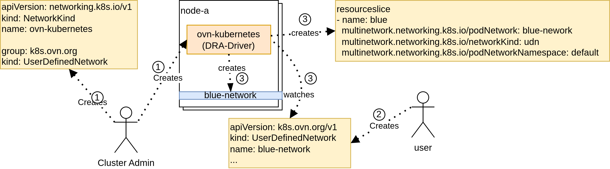
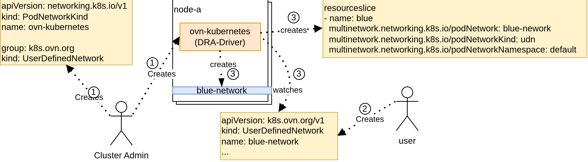

# PodNetworkKind

## Proposal

`PodNetworkKind` defines a Kubernetes-recognized pod network kind based on an implementation-specific pod network object type. It does not define networking behavior or semantics. Instead, it provides a classification and discovery mechanism that allows Kubernetes APIs and controllers to recognize and integrate multiple pod networks.

`PodNetworkKind` is a cluster-scoped resource. It is expected to be installed by the cluster administrator together with a pod network implementation.

A `PodNetworkKind` references a specific Group/Kind (GK) and multiple `PodNetworkKind` objects cannot reference the same GK. Any object matching this GK is considered a pod network instance belonging to that `PodNetworkKind`. As a result, a pod network instance belongs to exactly one `PodNetworkKind`. Users create implementation-defined pod network objects, while Kubernetes uses PodNetworkKind to recognize them as pod networks. A pod network is identified by its name, namespace (if applicable), and its associated `PodNetworkKind`.

A `PodNetworkKind` is immutable once created, so the Group/Kind referenced by a `PodNetworkKind` cannot be changed. A `PodNetworkKind` cannot be deleted while at least one pod network object belonging to that `PodNetworkKind` exists. A `PodNetworkKind` reports an `ImplementationTypeReady` status condition indicating whether the resource type referenced by its `ImplementationType` exists and is ready in the cluster.

The presence of at least one `PodNetworkKind` object indicates that pod network (multi-network) functionality is available in the cluster.

```go
import (
  metav1 "k8s.io/apimachinery/pkg/apis/meta/v1"
)

// PodNetworkKind describes a kind of pod networks implemented
// by a specific controller and represented by implementation-defined objects.
type PodNetworkKind struct {
  metav1.TypeMeta
  // Standard object's metadata.
  // More info: https://git.k8s.io/community/contributors/devel/sig-architecture/api-conventions.md#metadata
  // +optional
  metav1.ObjectMeta
  // spec is the desired state of the PodNetworkKind.
  // More info: https://git.k8s.io/community/contributors/devel/sig-architecture/api-conventions.md#spec-and-status
  // +optional
  Spec PodNetworkKindSpec
  // status is the current state of the PodNetworkKind.
  // More info: https://git.k8s.io/community/contributors/devel/sig-architecture/api-conventions.md#spec-and-status
  // +optional
  Status PodNetworkKindStatus
}

// PodNetworkKindSpec describes how pod network objects of this kind are identified.
type PodNetworkKindSpec struct {
  // ImplementationType identifies the API type of the pod network objects
  // belonging to this PodNetworkKind.
  // The ImplementationType may reference either a namespace-scoped or a cluster-scoped resource type.
  // +kubebuilder:validation:XValidation:rule="self == oldSelf",message="spec.implementationType is immutable"
  ImplementationType metav1.GroupKind
}

// PodNetworkKindStatus describes the observed state of the PodNetworkKind.
type PodNetworkKindStatus struct {
  // conditions is the list of conditions for this PodNetworkKind.
  // +optional
  // +listType=map
  // +listMapKey=type
  Conditions []metav1.Condition
}

// Well-known condition types for PodNetworkKinds.
const (
  // PodNetworkKindConditionImplementationTypeReady indicates whether the resource type referenced by the
  // PodNetworkKind's ImplementationType exists and is ready in the cluster.
  PodNetworkKindConditionImplementationTypeReady = "ImplementationTypeReady"
)

// Well-known condition reasons for PodNetworkKinds.
const (
  // PodNetworkKindReasonResourceTypeNotFound in the ImplementationTypeReady condition indicates
  // that the resource type referenced by the PodNetworkKind's ImplementationType does not exist
  // in the cluster.
  PodNetworkKindReasonResourceTypeNotFound string = "ResourceTypeNotFound"
  // PodNetworkKindReasonMissingRBAC in the ImplementationTypeReady condition indicates
  // that the necessary RBAC permissions are missing for the resource type referenced by the
  // PodNetworkKind's ImplementationType.
  PodNetworkKindReasonMissingRBAC string = "MissingRBAC"
  // PodNetworkKindReasonTypeConflict in the ImplementationTypeReady condition indicates
  // that another PodNetworkKind already references the same ImplementationType (Group/Kind).
  // A PodNetworkKind is considered valid only if it is strictly the oldest object by
  // metadata.creationTimestamp; any newer PodNetworkKind receives this reason.
  // If multiple PodNetworkKinds share the same creationTimestamp, all of them receive this reason.
  PodNetworkKindReasonTypeConflict string = "TypeConflict"
  // PodNetworkKindReasonCompliant in the ImplementationTypeReady condition indicates
  // that the resource type referenced by the PodNetworkKind's ImplementationType exists and is ready.
  PodNetworkKindReasonCompliant string = "Compliant"
)

// Well-known PodNetworkKind names.
const (
  // DefaultPodNetworkKindName is the reserved name for the default PodNetworkKind.
  DefaultPodNetworkKindName = "default"
)

// Finalizers for PodNetworkKinds.
const (
  // PodNetworkKindFinalizer is attached to a PodNetworkKind to prevent deletion
  // while pod network objects belonging to it still exist in the cluster.
  PodNetworkKindFinalizer = "multinetwork.networking.x-k8s.io/pod-network-kind-protection"
)
```

A pod network implementation must act as a Dynamic Resource Allocation (DRA) driver to conform to this design. The implementation is responsible for advertising each pod network instance as one or more devices via ResourceSlices. Each advertised device represents the ability to attach workloads to the corresponding pod network.

A ResourceClaim acts as the mechanism for attaching pods to pod networks. Users create requests in the ResourceClaim to select a specific pod network. The pod network implementation is responsible for allocating devices to satisfy these requests and for reporting the attachment status of workloads through the ResourceClaim device status.

Cluster administrators control how users may attach to pod networks by defining DeviceClass objects. Device classes can constrain which devices are selectable, allowing administrators to enforce cluster-level policies such as limiting access to particular pod networks.

**Note (Cross-Namespace Tenancy and Security):** `ResourceSlice` and `DeviceClass` are cluster-scoped resources, and DRA CEL selectors do not currently expose `ResourceClaim.metadata.namespace` (upstream [KEP-5291](https://github.com/kubernetes/enhancements/issues/5291) for fine-grained DRA resource access was closed as `not_planned`). As a result, DRA scheduling alone cannot prevent a `ResourceClaim` in one namespace from selecting a namespace-scoped pod network in another namespace. Until DRA provides native cross-namespace access control, implementations of namespace-scoped pod networks must enforce tenant isolation (for example, by rejecting unauthorized cross-namespace claims in the DRA driver during `NodePrepareResources`), or cluster administrators must restrict cross-namespace selection through admission policies (such as `ValidatingAdmissionPolicy`).

Each DRA driver manages the full lifecycle of devices representing pod network attachments, including allocation, deallocation, and updates to device attributes. This design does not interpret the semantics of these devices, it relies solely on standard device attributes and the device status to enable discovery, selection, and attachment of pod networks.

A pod network implementation may manage multiple `PodNetworkKind` objects and multiple types of pod networks. Multiple pod network implementations may manage the same `PodNetworkKind` or pod network type. In such cases, the implementations are responsible for coordinating among themselves (for example, using controller fields or labels). These interactions do not impact the design provided by `PodNetworkKind`.

### Resource Attributes

To integrate pod networks with Dynamic Resource Allocation (DRA), this proposal defines three new standard device attributes. These attributes allow `ResourceClaims` to select specific pod networks and allow the system to identify devices that attach workloads to a given pod network.

A device that attaches a workload to a pod network must report the associated ResourceClaim device status with a reference to the pod network in its `data` field. The relationship between an advertised device and a pod network is exposed via the device attributes in the corresponding ResourceSlice.

```golang
const (
  // StandardDeviceAttributePrefix is the prefix used for standard device attributes.
  StandardDeviceAttributePrefix = "multinetwork.networking.x-k8s.io" 

  // StandardDeviceAttributePodNetwork is a standard device attribute name
  // which describes a pod network.
  // The value is a string value referring to the name of an object from the GK defined in the 
  // StandardDeviceAttributePodNetworkKind attribute.
  StandardDeviceAttributePodNetwork resourceapi.QualifiedName = StandardDeviceAttributePrefix + "/" + "podNetwork"
  // StandardDeviceAttributePodNetworkNamespace is a standard device attribute name
  // which describes the namespace of a pod network.
  // The value is a string value referring to the namespace of a pod network object.
  // The attribute should not be set for the PodNetworkKind pointing to a non-namespaced GK.
  // The attribute is mandatory for the PodNetworkKind pointing to a namespaced GK.
  StandardDeviceAttributePodNetworkNamespace resourceapi.QualifiedName = StandardDeviceAttributePrefix + "/" + "podNetworkNamespace"
  // StandardDeviceAttributePodNetworkKind is a standard device attribute name
  // which describes a PodNetworkKind.
  // The value is a string value referring to an existing PodNetworkKind object.
  StandardDeviceAttributePodNetworkKind resourceapi.QualifiedName = StandardDeviceAttributePrefix + "/" + "podNetworkKind"
)
```

### Identification of a Pod Network

When a device representing a pod network attachment is allocated to a workload, the pod network implementation (acting as a DRA driver) reports the attachment details in the `ResourceClaim` device status.

To allow Kubernetes APIs and controllers to identify which pod network an interface is attached to without requiring them to query and join `ResourceSlice` objects, conforming DRA drivers populate the `data` field of the allocated device entry with a `PodNetwork` structure.

```go
// PodNetwork identifies a specific pod network instance.
type PodNetwork struct {
  // Kind identifies the PodNetworkKind responsible for the pod network.
  // +optional
  Kind string `json:"kind,omitempty"`

  // Name identifies the pod network object.
  Name string `json:"name"`

  // Namespace identifies the namespace of the pod network object.
  // Not set if the pod network object is a non-namespaced resource.
  // +optional
  Namespace *string `json:"namespace,omitempty"`
}
```

In addition to the `data.podNetwork` reference, the driver reports the network interface connection details in the standard `networkData` field (including interface name, hardware address, and assigned IPs).

Here is an example `ResourceClaim` status reporting the allocated device:

```yaml
apiVersion: resource.k8s.io/v1
kind: ResourceClaim
metadata:
  name: blue-network-attachment
spec:
...
status:
  allocation:
    devices:
      results:
      - device: blue-network-resource
        driver: udn.ovn-kubernetes.io
        pool: kind-worker
        request: blue-network
        shareID: 8e7acdf9-0290-4ecd-a801-a654b021d2b7
  devices:
  - data:
      podNetwork:
        kind: userdefinednetwork
        name: blue-network
        namespace: default
    device: blue-network-resource
    driver: udn.ovn-kubernetes.io
    networkData:
      hardwareAddress: 00:01:ec:84:fb:51
      interfaceName: net1
      ips:
      - 10.10.1.2/24
    pool: kind-worker
    shareID: 8e7acdf9-0290-4ecd-a801-a654b021d2b7
```

This self-contained reporting model ensures that controllers (e.g. EndpointSlice, network policy...) can unambiguously determine the network identity directly from the `ResourceClaim` status, without being affected by subsequent modifications to or deletions of `ResourceSlice` objects.

### Resource Category

Without a common `PodNetwork` API, there is no single resource type that represents all pod networks across implementations. Each implementation defines its own type (e.g. CustomResourceDefinition), so discovering all pod networks in a cluster requires knowing every implementation-specific type.

To address this, pod network implementations must register their resource type under the `podnetworks` category. Resource type categories allow `kubectl` to aggregate resources of different types under a single alias, enabling users to list all pod networks across all implementations with a single command: `kubectl get podnetworks`.

**Note:** Kubernetes API reviewers raised initial concerns about using the `podnetworks` resource category because category expansion takes precedence over resource type resolution in `kubectl`, which can collide with or shadow a future `podnetworks` resource (see [Kubernetes API Conventions — Short Names and Categories](https://git.k8s.io/community/contributors/devel/sig-architecture/api-conventions.md#short-names-and-categories)). This behavior is retained for `v1alpha1` experimentation and must be revisited before graduating beyond `v1alpha1`.

Below is an example CRD including the required `categories`:
```yaml
apiVersion: apiextensions.k8s.io/v1
kind: CustomResourceDefinition
metadata:
  name: userdefinednetworks.k8s.ovn.org
spec:
  group: k8s.ovn.org
  names:
    kind: UserDefinedNetwork
    listKind: UserDefinedNetworkList
    plural: userdefinednetworks
    shortNames:
    - udn
    singular: userdefinednetwork
    categories:
    - podnetworks
    - all
```

When multiple implementations are present, `kubectl` lists all matching resources grouped by resource type:
```sh
$ kubectl get podnetworks --all-namespaces
NAME                                            AGE
my-clusterwide-network.example.com/my-network   56s

NAMESPACE   NAME                                           AGE
default     userdefinednetworks.k8s.ovn.org/blue-network   37s
default     userdefinednetworks.k8s.ovn.org/red-network    45s
```

### Default PodNetworkKind

A cluster administrator can designate a `PodNetworkKind` as the cluster-wide default by naming it `default` (`metadata.name: default`).

In many clusters, only a single pod network implementation is installed, or one particular network type serves as the primary standard. Requiring users, manifests, and ecosystem APIs to always explicitly qualify network references with a `PodNetworkKind` introduces unnecessary verbosity and couples configurations to specific implementation types.

The default `PodNetworkKind` (named `default`) provides a cluster-wide fallback whenever the `kind` is omitted from a network reference:
* **Workload & ResourceClaim Portability:** Users can request attachment to a pod network simply by specifying the network name (and namespace, if applicable), without needing to know or hardcode the underlying implementation's `PodNetworkKind`.
* **Generic DeviceClasses:** Cluster administrators can define a common `DeviceClass` targeting the default `PodNetworkKind` (`default`). Workload manifests can then reference this standard class across environments regardless of the specific network provider deployed in the cluster.
* **Ecosystem API Integration:** High-level abstractions (e.g. Services, Gateway API routes, NetworkPolicies...) targeting pod networks can accept simple network name references and automatically resolve them to the `PodNetworkKind` named `default`.

**Note:** Using the reserved `default` name together with the 1:1 `ImplementationType` uniqueness constraint (`TypeConflict`) moves away from the `GatewayClass` and `IngressClass` model, where implementations register their own named classes and administrators can switch or migrate defaults between them. In this design, `default` is a platform- or administrator-owned singleton rather than an implementation-installed resource: an implementation cannot have both a named `PodNetworkKind` (for example, `userdefinednetwork`) and `default` referencing the same Group/Kind, and changing `default` to another Group/Kind requires deleting all existing pod network objects of that Group/Kind first due to deletion protection. Defaulting semantics and migration procedures will be revisited based on `v1alpha1` feedback.

Cluster administrators can define a `DeviceClass` targeting the default `PodNetworkKind`:

```yaml
apiVersion: resource.k8s.io/v1
kind: DeviceClass
metadata:
  name: default-pod-network-kind
spec:
  selectors:
  - cel:
      expression: device.attributes["multinetwork.networking.x-k8s.io"].podNetworkKind == "default" && has(device.attributes["multinetwork.networking.x-k8s.io"].podNetwork)
```

### Example

Note: OVN-Kubernetes is referenced in examples for illustrative purposes only. This proposal does not assume, require or imply that OVN-Kubernetes will adopt or implement the design described here.

A cluster admin defines which types of pod networks are available in the cluster by creating one or more `PodNetworkKind` objects. Each `PodNetworkKind` maps to a specific implementation-defined pod network resource.

```yaml
apiVersion: multinetwork.networking.x-k8s.io/v1alpha1
kind: PodNetworkKind
metadata:
  name: userdefinednetwork
spec:
  implementationType:
    group: k8s.ovn.org
    kind: UserDefinedNetwork
---
apiVersion: resource.k8s.io/v1
kind: DeviceClass
metadata:
  name: ovn-kubernetes-udn
spec:
  selectors:
  - cel:
      expression: device.attributes["multinetwork.networking.x-k8s.io"].podNetworkKind == "userdefinednetwork"
```

A pod network is declaratively defined using an implementation-specific pod network object. The pod network implementation prepares the underlying networking resources and advertises the availability of the pod network via the Resource API using a ResourceSlice.

```yaml
apiVersion: k8s.ovn.org/v1
kind: UserDefinedNetwork
metadata:
  name: blue-network
  namespace: default
spec: 
  ...
---
apiVersion: resource.k8s.io/v1
kind: ResourceSlice
metadata:
  name: kind-worker-ovn-kubernetes
spec:
  devices:
  - attributes:
      multinetwork.networking.x-k8s.io/podNetwork:
        string: blue-network
      multinetwork.networking.x-k8s.io/podNetworkNamespace:
        string: default
      multinetwork.networking.x-k8s.io/podNetworkKind:
        string: userdefinednetwork
    name: blue-network-resource
  driver: udn.ovn-kubernetes.io
  nodeName: kind-worker
  pool:
    name: kind-worker
```

A workload requests attachment to a pod network by creating a ResourceClaim. The claim selects a pod network by matching the standard device attributes exposed in the ResourceSlice.

```yaml
apiVersion: resource.k8s.io/v1
kind: ResourceClaim
metadata:
  name: blue-network-attachment
spec:
  devices:
    requests:
    - name: blue-network
      exactly:
        deviceClassName: ovn-kubernetes-udn
        selectors:
          - cel:
              expression: device.attributes["multinetwork.networking.x-k8s.io"].podNetwork == "blue-network" && device.attributes["multinetwork.networking.x-k8s.io"].podNetworkNamespace == "default"
```

Once the workload is attached to the pod network, the pod network implementation reports the attachment details in the ResourceClaim device status. This includes the `podNetwork` reference in the `data` field, as well as implementation-specific connection data in `networkData` such as interface name, hardware address, and assigned IPs.

```yaml
apiVersion: resource.k8s.io/v1
kind: ResourceClaim
metadata:
  name: blue-network-attachment
spec:
...
status:
...
  devices:
  - data:
      podNetwork:
        kind: userdefinednetwork
        name: blue-network
        namespace: default
    device: blue-network-resource
    driver: udn.ovn-kubernetes.io
    networkData:
      hardwareAddress: 5a:9f:d8:84:fb:51
      interfaceName: net1
      ips:
      - 10.10.1.2/24
    pool: kind-worker
```

**Note:** The selection of the `PodNetwork` and the `PodNetworkKind` can be done in the ResourceClaim but also in the DeviceClass.

Here is a diagram below representing the cluster preparation and the creation of a pod network:



1. A cluster administrator deploys a pod network implementation together with a `PodNetworkKind` that points to the Group/Kind of the implementation pod network resource.
2. A user (determined by the implementation itself) creates a pod network using the implementation-defined pod network object.
3. The pod network implementation provisions the underlying pod network and advertises its availability using a ResourceSlice.

Here is a diagram below representing the pod creation and its attachment to a pod network:



1. A user creates a Pod and an associated ResourceClaim requesting attachment to a pod network.
2. The pod network implementation attaches the Pod to the requested pod network.
3. The pod network implementation reports the attachment status to the ResourceClaim device status.

#### Default PodNetworkKind Example

A `PodNetworkKind` designated as the cluster default by naming it `default`:

```yaml
apiVersion: multinetwork.networking.x-k8s.io/v1alpha1
kind: PodNetworkKind
metadata:
  name: default
spec:
  implementationType:
    group: k8s.ovn.org
    kind: UserDefinedNetwork
status:
  conditions:
  - type: ImplementationTypeReady
    status: "True"
    lastTransitionTime: "2026-09-16T14:19:25Z"
    reason: Compliant
    message: "The resource type referenced by implementationType exists and is ready."
```

An example `DeviceClass` that selects the default `PodNetworkKind`:
```yaml
apiVersion: resource.k8s.io/v1
kind: DeviceClass
metadata:
  name: default-pod-network-kind
spec:
  selectors:
  - cel:
      expression: device.attributes["multinetwork.networking.x-k8s.io"].podNetworkKind == "default" && has(device.attributes["multinetwork.networking.x-k8s.io"].podNetwork)
```

An example `ResourceClaim` that requests a device from the default `PodNetworkKind`:
```yaml
apiVersion: resource.k8s.io/v1
kind: ResourceClaim
metadata:
  name: blue-network-attachment
spec:
  devices:
    requests:
    - name: blue-network
      exactly:
        deviceClassName: default-pod-network-kind
        selectors:
          - cel:
              expression: device.attributes["multinetwork.networking.x-k8s.io"].podNetwork == "blue-network"
```

### Implementation

The `PodNetworkKind` API enforces lifecycle and referential integrity constraints to ensure proper discovery, default selection, and protection against orphaning pod network objects.

A controller is provided alongside the API to reconcile and manage `PodNetworkKind` resources. Individual pod network implementations are not responsible for managing `PodNetworkKind` objects.

Validation must enforce the following:

* Immutability: The `spec` of a `PodNetworkKind` is immutable once created. Updates to the `spec` field must be rejected. This can be enforced via resource type level validation rules (e.g., CEL `x-kubernetes-validations`).

The controller must enforce the following:

* Deletion Protection (Finalizer): A `PodNetworkKind` cannot be deleted while pod network objects belonging to it still exist. The controller attaches a finalizer (`multinetwork.networking.x-k8s.io/pod-network-kind-protection`) to each `PodNetworkKind`. When a `PodNetworkKind` is marked for deletion (`metadata.deletionTimestamp` is set), the controller checks whether any objects of the referenced Group/Kind exist in the cluster. If at least one such object exists, the controller retains the finalizer to block deletion. Once all pod network objects belonging to that `PodNetworkKind` are deleted, the controller removes the finalizer, allowing the deletion to complete.

* ImplementationTypeReady Condition: The controller must watch `PodNetworkKind` objects and the resource types in the cluster. For each `PodNetworkKind`, the controller must look up the resource type matching the referenced Group/Kind and update the `ImplementationTypeReady` condition accordingly:
  * The condition is set to `True` with the reason `Compliant` if the other reasons for setting it to `False` do not apply.
  * The condition is set to `False` with the reason `ResourceTypeNotFound` if the resource type does not exist.
  * The condition is set to `False` with the reason `MissingRBAC` if the necessary RBAC permissions are missing.
  * The condition is set to `False` with the reason `TypeConflict` if another `PodNetworkKind` already references the same Group/Kind.

* Default PodNetworkKind Resolution: When a network reference omits the `kind`, higher-level controllers and abstractions resolve it to the `PodNetworkKind` named `default`. Uniqueness is guaranteed by Kubernetes standard resource naming (only one cluster-scoped `PodNetworkKind` named `default` can exist at a time).

#### E2E Tests

E2E tests validate that the `PodNetworkKind` lifecycle and validation constraints are correctly enforced in a running cluster.

E2E tests validate:
* Deletion Protection:
  1. Creating a `PodNetworkKind` results in the controller attaching the `multinetwork.networking.x-k8s.io/pod-network-kind-protection` finalizer.
  2. Deleting a `PodNetworkKind` succeeds (finalizer is removed) when no pod network objects of the referenced Group/Kind exist.
  3. Deleting a `PodNetworkKind` is blocked (finalizer is retained) when at least one pod network object of the referenced Group/Kind exists in the cluster.
  4. After deleting all pod network objects of the referenced Group/Kind, the controller removes the finalizer and deleting the `PodNetworkKind` completes.
* Immutability:
  1. Updating the `spec.implementationType` of an existing `PodNetworkKind` (e.g., changing the Group/Kind) is rejected.
  2. Updating the `metadata` (e.g., labels, annotations) of an existing `PodNetworkKind` succeeds.
* ImplementationTypeReady Condition:
  1. Creating a `PodNetworkKind` referencing an existing and ready resource type results in the `ImplementationTypeReady` condition being set to `True` with reason `Compliant`.
  2. Creating a `PodNetworkKind` referencing a non-existent resource type results in the `ImplementationTypeReady` condition being set to `False` with reason `ResourceTypeNotFound`.
  3. Deleting the resource type referenced by a `PodNetworkKind` results in the `ImplementationTypeReady` condition being updated to `False` with reason `ResourceTypeNotFound`.
  4. Creating the resource type referenced by a `PodNetworkKind` that previously had `ImplementationTypeReady` set to `False` results in the condition being updated to `True`.
  5. Creating a second `PodNetworkKind` referencing the same Group/Kind as an existing (older) `PodNetworkKind` results in the second `PodNetworkKind` having `ImplementationTypeReady` condition set to `False` with reason `TypeConflict`, while the older remains `True` with reason `Compliant`.
  6. Creating two `PodNetworkKind` objects referencing the same Group/Kind with identical `metadata.creationTimestamp` results in both objects having `ImplementationTypeReady` condition set to `False` with reason `TypeConflict`.
  7. After deleting one of the conflicting `PodNetworkKind` objects, the remaining `PodNetworkKind` has its `ImplementationTypeReady` condition updated to `True` (assuming its resource type is ready).
  8. Creating a `PodNetworkKind` without sufficient RBAC permissions results in the `ImplementationTypeReady` condition being set to `False` with reason `MissingRBAC`.
  9. Granting sufficient RBAC permissions to a `PodNetworkKind` that previously had `ImplementationTypeReady` set to `False` results in the condition being updated to `True`.
* Default PodNetworkKind:
  1. Creating a `PodNetworkKind` named `default` succeeds and serves as the default PodNetworkKind.

#### Conformance Tests

Conformance tests validate that a pod network implementation correctly integrates with `PodNetworkKind` and the Kubernetes Resource API. These tests ensure that pod networks are discoverable, selectable, and observable using standard Kubernetes mechanisms.

Conformance tests validate:
* Resource type Category: A pod network implementation must include the `podnetworks` category in its resource type definition.
  1. The resource type referenced by a `PodNetworkKind` includes `podnetworks` in its categories.
  2. Pod network objects of the referenced Group/Kind are listed when querying the `podnetworks` category (e.g., `kubectl get podnetworks`).
* ResourceSlice Advertisement: A pod network implementation must advertise each pod network instance using a ResourceSlice.
  1. For every pod network object matching the Group/Kind referenced by a `PodNetworkKind`, at least one ResourceSlice is created.
  2. Each advertised device includes the following attributes:
    * `multinetwork.networking.x-k8s.io/podNetwork`, identifying the pod network instance.
    * `multinetwork.networking.x-k8s.io/podNetworkKind`, identifying the corresponding PodNetworkKind.
    * `multinetwork.networking.x-k8s.io/podNetworkNamespace`, identifying the kubernetes namespace of the pod network instance if the pod network object is namespace-scoped. This attribute must not exist if the pod network object is cluster-scoped.
  3. The advertised attributes accurately reflect the pod network object name, namespace (if applicable) and kind.
* ResourceClaim Pod Network Selection: A pod network implementation must support attaching a Pod to a pod network via ResourceClaim selection using standard device attributes.
  1. A ResourceClaim (in the same namespace as the pod network when the pod network object is namespace-scoped) selecting a pod network via the `multinetwork.networking.x-k8s.io/podNetwork`, the `multinetwork.networking.x-k8s.io/podNetworkNamespace` (if applicable) and the `multinetwork.networking.x-k8s.io/podNetworkKind` attributes can be successfully allocated.
  2. The allocation results in a device being bound to the ResourceClaim.
  3. The selected device corresponds to a pod network advertised via a ResourceSlice.
* ResourceClaim Pod Network Status Reporting: A pod network implementation must report network attachment status through the ResourceClaim device status.
  1. For a Pod successfully attached to a pod network, the ResourceClaim status includes a device entry.
  2. The reported device includes the `podNetwork` object in `status.devices[].data`, stating the associated `kind`, `name`, and `namespace` (if applicable).
  3. The reported status includes sufficient information in `networkData` to identify the pod network attachment, such as:
    * Network interface name
    * Hardware address (if applicable)
    * Assigned IP addresses (if applicable)

### Conceptual Ecosystem Integration

The following section is not a proposal to modify the Service Kubernetes APIs. It is a conceptual illustration only, intended to demonstrate how the `PodNetworkKind` abstraction proposed above could be integrated with other Kubernetes ecosystem APIs in the future. This section defines no requirements, no commitments, and no implied API changes.

Conceptually, Kubernetes APIs that need to operate on a specific pod network could reference a pod network using a (kind, name) tuple. This allows APIs to identify a pod network without understanding its implementation details.

```golang
// PodNetwork identifies a specific pod network instance.
type PodNetwork struct {
  // Kind identifies the PodNetworkKind responsible for the pod network.
  // +optional
  Kind *string

  // Name identifies the pod network object.
  // +required
  Name *string

  // Namespace identifies the namespace of the pod network object.
  // Must be set for namespace-scoped pod network objects and un-set
  // for non-namespace-scoped pod network objects.
  // +optional
  Namespace *string
}
```

The following example shows how a Kubernetes Service API could conceptually reference a pod network using `PodNetworkKind`. This is provided solely as an example to illustrate how `PodNetworkKind` enables ecosystem integration.

```golang
// Service describes what network traffic is allowed for a set of pods
type Service struct {
  metav1.TypeMeta

  // +optional
  metav1.ObjectMeta

  // spec represents the specification of the desired behavior for this Service.
  // +optional
  Spec ServiceSpec
}

// ServiceSpec provides the specification of a Service
type ServiceSpec struct {
  // PodNetwork selects the pod network this Service applies to.
  // If nil, the default pod network is used.
  // +optional
  PodNetwork *PodNetwork

  ...
}

// ServiceStatus represents the current status of a service
type ServiceStatus struct {
  // PodNetwork specifies the pod network this Service is currently applied to.
  // This field is set by the PodNetworkKind controller and reflects the actual pod network
  // the Service is applied to.
  //
  // If the spec.PodNetwork.Kind is nil, then the PodNetworkKind controller will look for the default 
  // PodNetworkKind (named "default") and set the status.PodNetwork.Kind to "default". 
  // If no PodNetworkKind named "default" exists in the cluster, the status.PodNetwork.Kind will be nil and a warning 
  // condition will be set to indicate that no default PodNetworkKind is available.
  // If the spec.PodNetwork.Kind is not nil, then the PodNetworkKind controller will set the 
  // status.PodNetwork.Kind to the spec.PodNetwork.Kind.
  //
  // If nil, the legacy behavior is used, which is to apply the
  // Service to the default pod network.
  // +optional
  PodNetwork *PodNetwork

  // Current service condition
  // +optional
  Conditions []metav1.Condition
}
```

Example Service Definition (Conceptual):

```yaml
apiVersion: v1
kind: Service
metadata:
  name: my-service
  namespace: default
spec:
  podNetwork:
    name: blue-network
  selector:
    app.kubernetes.io/name: MyApp
  ports:
  - protocol: TCP
    port: 80
    targetPort: 9376
status:
  podNetwork:
    kind: default # "default" is the default PodNetworkKind name, resolved and set by a controller.
    name: blue-network
    namespace: default # The namespace was omitted in the spec, but resolved automatically in the status by a controller.
```

## Alternatives

### PodNetwork

An alternative approach discussed was the introduction of a `PodNetwork` API representing a pod network instance directly.

In this model, `PodNetwork` is a cluster-scoped object containing a small set of common, implementation-agnostic fields (such as `provider` and `networkRef`). Rather than embedding implementation-specific networking semantics into a single monolithic API, the `PodNetwork` object references a separate, implementation-defined resource describing the actual network configuration:

```yaml
apiVersion: multinetwork.networking.x-k8s.io/v1alpha1
kind: PodNetwork
metadata:
  name: blue-network
spec: 
  provider: ovn-kubernetes
  networkRef:
    group: k8s.ovn.org
    kind: UserDefinedNetwork
    name: blue-network
    namespace: default
---
apiVersion: k8s.ovn.org/v1
kind: UserDefinedNetwork
metadata:
  name: blue-network
  namespace: default
spec: 
  ...
```

Under this approach, creating a pod network requires maintaining two resources for every network instance:
1. A cluster-scoped `PodNetwork` object, used by Kubernetes APIs and ResourceClaims to reference the network by a single name.
2. An implementation-specific network object (e.g., `UserDefinedNetwork`), reconciled by the network provider's controller.

While this approach provides a single simple reference to a pod network, it introduces architectural trade-offs:
* **Object Duplication:** Creating two objects per network instance increases API server overhead and requires continuous synchronization between the `PodNetwork` and the implementation CR.
* **Naming Conflicts across Providers:** A flat cluster-scoped namespace allows multiple providers to collide when creating networks with identical names.
* **Scope Mismatch:** Mapping namespace-scoped implementation CRs to cluster-scoped `PodNetwork` objects causes collisions when different namespaces define networks with the same local name.

### Network Interface Selection

Another alternative approach is to avoid introducing any dedicated network API resource altogether (neither `PodNetworkKind` nor `PodNetwork`).

In this model, the multi-network project does not define or manage network objects in Kubernetes. Instead, network provisioning and workload attachment rely entirely on native Dynamic Resource Allocation (DRA). Ecosystem integrations (e.g. Services, Gateway API, NetworkPolicies...) interact directly with pod network interfaces by selecting them based on interface names, labels, driver names, or custom properties reported in the `ResourceClaim` device status.

A DRA driver allocates a network device to a pod and populates the `ResourceClaim` status with implementation-specific metadata:

```yaml
apiVersion: resource.k8s.io/v1
kind: ResourceClaim
metadata:
  name: blue-network-attachment
spec:
  ...
status:
  allocation:
    devices:
      results:
      - device: eth1
        driver: cni.dra.networking.x-k8s.io
        pool: kind-worker
        shareID: 8e7acdf9-0290-4ecd-a801-a654b021d2b7
  devices:
  - data:
      labels:
        podNetwork: blue-network
        implementation: userdefinednetwork
    device: eth1
    driver: cni.dra.networking.x-k8s.io
    networkData:
      hardwareAddress: 5a:9f:d8:84:fb:51
      interfaceName: net1
      ips:
      - 10.10.1.2/24
    pool: kind-worker
    shareID: 8e7acdf9-0290-4ecd-a801-a654b021d2b7
```

Higher-level ecosystem APIs (e.g. NetworkPolicy, Services...) then reference the interface directly:

```yaml
apiVersion: networking.k8s.io/v1
kind: NetworkPolicy
metadata:
  name: my-policy
spec:
  networkInterfaceRef:
    interfaceName: net1
    labels:
      podNetwork: blue-network
      implementation: userdefinednetwork
```

While this approach eliminates the need for a new cluster-level network API, it presents drawbacks:
* **Tight Coupling to Interface Names and Drivers:** Policies, services, and workload configurations must reference low-level interface names (such as `net1`) or driver-specific fields, which can vary across nodes and implementations, breaking workload and policy portability.
* **Lack of Discovery and Inventory:** Cluster administrators and users cannot query or list available networks (`kubectl get podnetworks`), nor can they discover which network implementations and types are active in the cluster.

